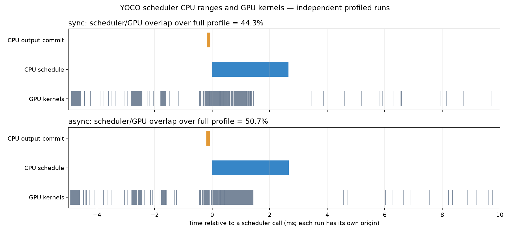

# YOCO fixed-K8 异步调度实验

2026-10-22。基线 `c616521d8c`，实验分支
`fhb-dev-yoco-async-scheduling-20261022`。

2026-10-22已将 `abcade593a`、`c183d6568e` 合入
`fhb-dev-aligndeepinfer-startpoint`，异步调度继续显式选择。
下述数值保留原冻结配置：该基线使用FP32/TF32 router，当前开发分支同时保留
`a5a93f9907` 的BF16 router默认，不能把历史收益当作组合版本的复测结果。

后续 [长输出 / 16K / C16-C32 补测](LONG_LOAD_REPORT.md) 已完成：
短输入长输出可重复提升 +4.93%～+13.14%，16K 输入无稳定正收益。
下文保留初轮 C1/C4/C8 的原始结果和边界。

**结论：现有 vLLM 异步调度已在单卡 YOCO / Shared-KV K8 / FULL Graph / Mega hybrid
组合跑通。功能基础不需要重写 scheduler；本分支完成配置解耦、运行回执、状态回归和原生请求测试。
性能随负载变化：64 输出面板吞吐变化 −3.38%～+0.88%，256 输出的单轮对照为
+2.25%～+2.94%。已合入主开发分支，保留为显式选项，不改变默认调度策略。**

## 改动

- 将 engine 进程布局与 scheduler 模式分开：`--engine-mode`、`--scheduler-mode`。
  历史 `--synchronous-engine` 仍保留“in-process + sync”的语义；组合歧义直接拒绝。
- worker 回执记录实际 scheduler 类、async flag、batch queue 容量、executor、进程、MoE 和图回放。
  显式请求的模式没有实际生效时失败，避免把 auto/default 当成已启用。
- 增加原生 AsyncLLM 到达时间重放、不同输出预算、EOS 和客户端取消的验证入口。
  两组都使用 AsyncMPClient，Python async API 与 engine async scheduler 分开对照。
- 增加独立 profile 模式、scheduler CPU 范围标注和 Perfetto Chrome trace 导出；停止时恢复方法并释放 profiler。
- 扩展 Shared-KV 回归：CPU 长度上界领先一个 K8 时，仍依据 GPU 的实际位置/拒绝结果选择 raw h20 和 KV 前缀。

没有修改 `vllm/` 的 scheduler、worker、模型或 kernel 执行代码，也没有更换运行库。
这里的接入基于现有 vLLM async 实现；未将已有功能重新记作新算法。

## 固定配置与硬件

单张 B200、V2、TP1/PP1/DP1、无 CP/DBO；FP8 target、BF16 draft/KV、FP32 proposal cache、固定 K8。
target 为 balanced 30A3B，draft 为 step30000。maxlen12288、maxseq8、batch tokens2048、KV8GiB。
APC 关闭，T1/top_p1，MoE auto 为小 M Triton、decode M≥17 Mega；target4/draft6 图保持。

两组显式使用相同多进程 engine 布局与同一 executor；只切 `async_scheduling`。
回执确认同步为 `Scheduler`/容量1，异步为 `AsyncScheduler`/容量2。
容量不是实测的每时刻在途深度；执行重叠由另外的 profile 观察。

Pod 为 `living-cobra-b200g4-dev-f5def941-master-0`，UID
`9a026fd8-e732-4fcb-b855-85ea6a6358ed`，node `slc01-cl02-hgx-0347`。
只使用 GPU7 / `GPU-4549436e-8247-c0d0-26a8-3b48a91fe43e`，持有既有 gpu7 advisory lock，
加载前核对空闲。其他 GPU/CPU 上有任务，因此不能将本轮小幅差异外推为独占节点性能。

沿用 Torch2.13/cu130、Triton3.7.1、DeepGEMM2.8.2。
DeepGEMM 扩展 SHA256 为
`c0f54cacf14e6024921bd9f34d2119c77b3f5544d8194110e97ed60cf0465d41`，
前后原生库哈希一致。MLOPart 不可用告警保留，沿用普通内存回退，未更改共享 MPS。

## 64 输出：原生 A/B/B/A

顺序为 sync-a1 → async-b1 → async-b2 → sync-a2。同 GPU，短输入/8193-token × C1/C4/C8，
每请求固定64输出、忽略EOS。每格每轮2次预热、3个正式seed；72个正式batch、312个请求、19968输出token。
相同seed重跑不当成独立prompt样本。吞吐取总完成token/总耗时，包含prefill、decode、采样、调度和GPU drain。
加载、编译、分词、HTTP及profiler在计时外。

| 输入 | C | sync 输出 tok/s | async 输出 tok/s | 变化 |
| --- | ---: | ---: | ---: | ---: |
| short | 1 | 288.27 | 281.21 | −2.45% |
| short | 4 | 588.22 | 579.94 | −1.41% |
| short | 8 | 1007.97 | 1016.82 | +0.88% |
| 8193 | 1 | 106.33 | 104.14 | −2.06% |
| 8193 | 4 | 129.35 | 125.61 | −2.89% |
| 8193 | 8 | 138.29 | 133.61 | −3.38% |

短请求C4的请求平均TPOT P95从4.29ms降到3.52ms，但TTFT P95从222.3ms升到234.6ms，
完整请求吞吐没有提升。该TPOT统计不是逐token ITL P95。正式样本无corruption、无抢占、无输出预算不足。
按日志定位，正式trial未见Triton JIT告警；启动/预热告警保留，未据此宣称全部原生DG窗口零JIT。

## 256 输出：针对较长 decode 的补充单轮对照

短输入、C1/C4/C8，其他设置相同，每请求256输出。先sync后async，各格2次预热、3个正式seed；
共18个正式batch、78个请求、19968输出token。本轮没有第二次ABBA，单独报告，不与前表混成统一收益。

| C | sync 输出 tok/s | async 输出 tok/s | 变化 |
| --- | ---: | ---: | ---: |
| 1 | 408.44 | 417.65 | +2.25% |
| 4 | 928.79 | 953.68 | +2.68% |
| 8 | 1533.65 | 1578.66 | +2.94% |

补测动机是前一面板中生成阶段TPOT有所改善，而短输出的prefill/TTFT占比较大。
这些点估计支持继续研究较长decode场景，尚不证明稳定的服务容量提升。

## 持续到达、EOS 与取消

原生AsyncLLM，两组回放完全相同的16条请求计划，间隔20ms，混合短输入/8193-token、24/40/64/128输出预算。
部分短回答允许EOS，两个请求在收到第二个非空输出更新后关闭生成流，验证客户端取消。

每组均为14条正常完成、2条取消；正常完成包含1条自然stop和13条length结束，最终未完成请求数0。
正常完成输出707token；计时包含GPU drain。每个更新可能携带多个投机token，记录的是更新间隔和请求平均TPOT，
没有将它们命名为逐token ITL P95。

sync/async观测吞吐约258.00/251.52 tok/s，TTFT P95约2206.7/2295.1ms。
这是单次请求生命周期面板：取消按输出更新数触发、实际投机工作量和批次组成可能不同，
主要用于流程验收，不作为容量或稳定性能结论。

## 数值与正确性边界

64输出的两个配对中，固定teacher-forced轨迹共256个logprob位置全部逐位相等，首token面板也相等。
完整生成有122/156条配对请求逐位一致；C1的12/12一致，多请求生成后段存在差异。
实际图桶回放计数也随调度变化。当前Fast/Mega未提供batch-invariant保证，固定seed不能保证跨batch输出相同；
本轮没有完成所有生成分歧的逐轮因果定位，因此不宣称跨batch数值等价或一般任务质量通过。

GPU状态回归核对了raw h20选择、GPU positions、严格prefix、非连续request slot、bonus column及chunked prefill。
当前真实面板没有触发KV压力抢占；通用scheduler回归不能替代YOCO实模抢占/恢复验收。

## Profile 与退出清理

独立同步/异步profile分别保留71423/67769个GPU kernel事件，捕获scheduler planning和output commit范围。
全profile中，CPU schedule范围与GPU kernel时间区间的重叠比例约44.3%/50.7%。
这是带采集开销的范围重叠，工作量也不完全相同，不能当作未采集时的CPU利用率、关键路径占比或加速比例。
同步配置本来就有部分worker侧重叠；新增流水能力并不保证整体更快。

图中每个面板使用自己的时间原点，是实际局部窗口，不能按横向位置把两个运行的事件配对。
原始Chrome JSON可用Perfetto打开；没有从离线推断阶段伪造NVTX事件。

首次profile-sync退出触发vLLM默认短超时及内部强制清理兜底，失败日志保留。
最终入口在stop后释放profiler对象、恢复调度标注，并以60秒等待优雅关闭。
重跑的异步profile通过，约4秒完成普通SIGTERM清理，没有force-kill告警。

## 验证、隔离与复现

- 本地scheduler/V2输入/Shared-KV回归63项、工具回归14项通过，共77项；包含profiler资源释放/恢复回归。
- 最终B200 Shared-KV/prefill回归96项通过，无skip；更早的95项和后续96项存在重叠，不相加。
- 适用pre-commit和手动mypy3.12检查通过；最终新增报告再做文档检查。
- 远端执行快照各8078个源码文件、1996个运行时支持文件验签通过；原生库前后哈希不变。
  执行后的增量是profiler清理单元回归和报告；涉及推理的执行代码与最后快照一致。
- 所有测试进程已退出，GPU7最终0MiB，共享锁可重新获取；Pod UID/node/restart count=0保持。
  没有修改其他GPU上的服务、Job或共享运行库。

[使用说明](../ASYNC_SCHEDULING.md)、[汇总JSON](summary.json)、[原生面板CSV](native-trials-summary.csv)、
[profile统计](profile-summary.json)。

完整本地产物在 `/data/vllm_test/work/yoco-async-scheduling-20261022/`：
`attempt1`为eager功能smoke，`attempt2`为FULL/Mega原生ABBA与首轮生命周期，
`attempt3`为EOS/取消及独立profile，`attempt4`为256输出补测，`attempt5`为最终清理重跑与原生库审计。
各轮脚本、配置、source manifest、原始请求/输出/metrics、日志和退出码均保留。

当前不默认开启async；可显式选择sync回退。APC、结构化输出、P/D、多卡及adaptive均未因此获得组合验收。
