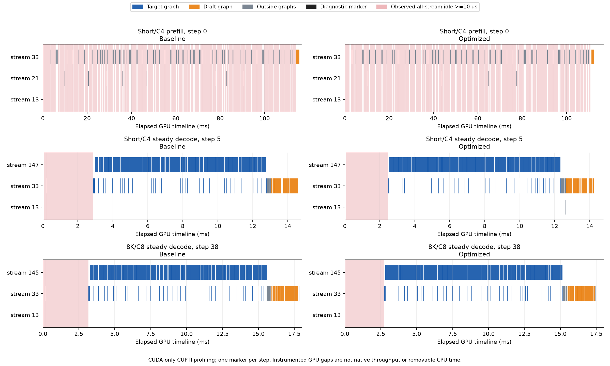

# YOCO CPU / CUDA Graph 执行路径检查与优化

2026-10-21（America/Los_Angeles），开发基线 `d4b0c39f8f72b130b8cfdae34a3426cf6f65811a`。
配置沿用 B200、TP1、V2、FP8 target、BF16 KV、DSpark K8、fast-prefill；APC与异步调度关闭。
本轮沿用已合入的四warp latent输入融合及现有YAML auto策略。

## 结果

本轮改善了decode的CPU metadata准备与图提交路径。最终无profiler交错面板中，
短输入C1/C4/C8吞吐分别提升 **3.16% / 3.07% / 2.56%**，8193输入提升 **1.73% / 1.17% / 0.93%**。
单输出token完成耗时的变化在±0.14%内，未证明prefill收益。
60组正式/预热配对的完整输出IDs、接受/提议计数及逐位置接受计数一致。

修改只涉及CPU整数计算与最终不用的prefill元数据准备，保留原模型计算、采样、量化、YAML和GPU图内执行。
生产图仍为 **target4 / draft6**，共享Mega workspace仍为1个；没有新增图池或图形状。

## 时间线如何测量

先采CPU+CUDA trace定位调用，再采CUDA-only CUPTI trace降低CPU算子记录开销。
每个真实执行步在主stream上插入一个约1～2μs的诊断marker，按GPU顺序定位该步；marker不进入生产代码。
记录真实InputBatch token/request数、图描述符、prefill状态，以及GPU侧draft准备kernel的实际grid。

对**全部stream**的kernel、memcpy、memset时间区间取并集；并集相邻区间之间才记为GPU无活动空档。
将下一次GPU activity关联到它的CUDA launch API，直接测量空档内“尚未进入API”的区间，
另列已经提交、但尚未执行的间隔。没有使用CPU total减GPU total，也没有把output event等待当作CPU计算。
图中的target/draft归属通过CPU trace中真实GraphLaunch的kernel名称/数量签名交叉核对；最终audit中无缺失API或未知图归属。

原生计分期间关闭profiler和GPU marker；只保留两侧相同的少量CPU观察包装。
CUDA-only采样依然会放大GraphLaunch/提交开销，所以下面的空档比例、CPU墙钟及提交间隔是**采样条件下的观察值**，
不能当作无profiler利用率或可全部消除的性能空间。最终吞吐另由无profiler面板给出。

Nsight Systems 2026.1的三次尝试在正式计分前阻塞于D2H事件等待，未使用其结果；日志保留。
只终止了本任务采样进程，未重启Pod或服务。最终数据来自正常完成的PyTorch/CUPTI采集。

## Prefill 与稳态decode分开观察

Prefill使用非完整图路径，可直接看到许多后续launch在前一段GPU工作结束后才到达。
CPU调用分析中，17个prefill/mixed执行步触发527次FlashInfer metadata build（31组/步），
并包含550次opaque MoE调用、7370次Triton launch和3317次DeepGEMM线性GEMM调用。
这些调用数解释了需要检查的提交路径；未把它们的嵌套累计时间相加或与GPU total相减。

Prefill的主要空档仍遍布opaque MoE、Triton与DeepGEMM提交链路。
本轮两项较小的控制路径修改没有解决这段大头：最终采样中短输入/C4纯prefill无活动比例约85.94%→85.54%，
8193/C8首段纯prefill约75.33%→75.51%，mixed约69.62%→69.62%；无profiler单token测试也基本持平。
纯prefill只统计所有已调度行都在prefill的步，mixed另列；8193/C8早期纯prefill主要处理首个请求的chunk，
不能把它叫作8个请求同时prefill的GPU批次。

稳态decode在完整target/draft图之间出现提交空档。CPU墙钟scope包含metadata本身及它发出的提交调用：

| 稳态窗口 | metadata CPU墙钟 ms/步：原→优化 | 降低 | 相邻target图提交间隔中位数 ms：原→优化 | 采样内全部stream无活动比例：原→优化 |
| --- | --- | ---: | --- | --- |
| 短输入/C4 | 1.324 → 0.938 | 29.15% | 14.712 → 14.322 | 21.50% → 18.82% |
| 8193/C8，256输出 | 1.337 → 0.951 | 28.86% | 18.041 → 17.575 | 20.53% → 18.21% |

短输入/C4取真实步骤3～10；8193/C8取步骤36～43，每步都是8个请求、target72行、draft64行。
初次64输出token的8193/C8实验没有形成恒定8并发decode，不能用其降并发尾段冒充C8；
因此额外将输出延长到256，实际观察到上述8步稳态窗口。其输出IDs在两侧也完全一致。



蓝色为target图、橙色为draft图、灰色为图外工作，红底为全部stream同时无活动且持续≥10μs的区间。
这是采样时间线，图中的绝对延迟不作为正式吞吐结果。

## 两项实现

1. `vllm/v1/attention/backends/utils.py` 的 `split_decodes_and_prefills` 和
   `vllm/v1/attention/backends/flashinfer.py` 的 `_compute_decode_query_lens`：
   使用当前CPU offset的NumPy view执行整数比较/归约，避免多组metadata重复创建小Torch CPU张量。
   保留原快捷返回；不读GPU数据、不增加同步、不跨步缓存。GPU ragged offsets、零长度padding、XQA/TRTLLM返回值保持原语义。
2. `vllm/v1/worker/gpu/model_runner.py` 与 `model_states/yoco.py`：
   用CPU状态先决定是否需要完整prefill，再准备compact索引；避免准备后丢弃的buffer copy/填充。
   中间chunk、mixed/output chunk、prompt-logprob/full-row消费者、P/D producer的既有行为继续由对应条件控制。

## 实际padding

target使用真实InputBatch的行数和padding后行数；draft使用实际`_prepare_shared_kv_inputs` GPU grid，
未执行proposal的chunk不计虚构的draft padding。下表比例为padding行数/执行总行数，统计整个audit中对应阶段。
GPU计时只取前述8步采样窗，padding统计则包括窗外所有恒定并发步，二者不混淆。

| 输入与请求并发 | 阶段 | 步数 | target padding比例 | draft padding比例 |
| --- | --- | ---: | ---: | ---: |
| 短输入/C4 | 恒定并发decode | 20 | 0.00% | 0.00% |
| 短输入/C4 | 降并发尾段 | 10 | 22.58% | 0.00% |
| 8193/C8，256输出 | 恒定并发decode | 18 | 0.00% | 0.00% |
| 8193/C8，256输出 | 降并发尾段 | 73 | 19.35% | 17.58% |

当前C1/C4/C8恒定并发时匹配现有图，没有该项padding浪费。降到3/5/6/7个请求时可能落到更大的图；
例如target五请求45行补到72行，单步padding比例37.5%。本轮保留有限图集合，没有靠增加capture形状改变这部分。

## 无profiler端到端验收

每格2次预热、3个正式种子，T=1、top_p=1、ignore_eos；计时包括prefill、decode、采样、调度和GPU drain，
不含加载、编译、分词、HTTP。max_model_len12288、max_num_seqs8、batch tokens2048、KV固定8GiB。
同一引擎交错切换从原始d4b源码提取的CPU方法与候选方法，使用同一组权重/KV/图和相同随机键。
单token完成耗时包含采样、初次proposal及调度，不是纯GPU prefill kernel时间。

| 输入 | 并发 | 单token批完成耗时 ms：原→优化 | 单token延迟降低 | 128输出token吞吐 tok/s：原→优化 | 吞吐变化 |
| --- | ---: | --- | ---: | --- | ---: |
| 短输入 | 1 | 94.03 → 94.09 | -0.06% | 336.23 → 346.85 | +3.16% |
| 短输入 | 4 | 95.37 → 95.38 | -0.00% | 888.97 → 916.27 | +3.07% |
| 短输入 | 8 | 96.73 → 96.87 | -0.14% | 1518.48 → 1557.38 | +2.56% |
| 8193 | 1 | 420.32 → 420.21 | +0.03% | 172.01 → 174.98 | +1.73% |
| 8193 | 4 | 1449.90 → 1449.86 | +0.00% | 236.01 → 238.77 | +1.17% |
| 8193 | 8 | 2825.09 → 2825.90 | -0.03% | 264.27 → 266.72 | +0.93% |

此前candidate2独立面板也得到短输入+2.51%～+3.13%、8193输入+0.83%～+1.86%的点估计；
它是中间版本交叉检查，最终表格只用candidate3。结果限于这套离线固定工作负载及3个正式种子，
不外推多卡、APC、异步调度、HTTP或在线容量。

## 回归与可复查产物

- B200选中测试：attention splitting27、FlashInfer metadata7、V2 runner19、YOCO/prefill/Shared-KV123，共 **176通过**。
  132项其他attention backend测试未选中；选中项零skip。
- 12,000组原/新CPU算法对照通过，覆盖int32/int64、非连续及实时更新的CPU offset、padding/mixed、XQA/TRTLLM和空decode子集。
- 60组配对中36组正式、24组预热；输出IDs、接受/提议计数和逐位置接受计数全部一致，无corruption或preemption。
- 补充的短输入/C4、8193/C8长输出audit也输出一致，target/draft仍4/6，Mega workspace仍1个。
- 原有stale-is-prefilling测试的MagicMock误入无关fast-prefill/DP分支，本轮显式关闭该测试不涉及的fast-prefill选项，保留其原有断言。

最终运行：`/data/vllm_test/work/yoco-cpu-graph-path-20261021/candidate3/`。
`run_candidate3.sh`、`cpu_graph_ab.py`、`trace_path_light.py`、基线CPU方法、配置和冻结源码manifest保留在该目录；
原始trace在其`traces/`，初始完整/轻量时间线分别在工作根目录的`baseline/`和`baseline-light/`。
8066个tracked源码文件与缺失运行时支持文件逐个校验，执行文件与最终提交版本一致；报告是在执行后加入。
沿用现有Torch2.13/cu130、Triton3.7、DeepGEMM2.8.2运行库，无依赖升级。

```bash
.venv/bin/python -m pytest --confcutdir=tests/v1/attention -q tests/v1/attention/test_attention_splitting.py
.venv/bin/python -m pytest --confcutdir=tests/v1/attention -q tests/v1/attention/test_attention_backends.py -k 'flashinfer and (query_lens or draft_masks)'
.venv/bin/python -m pytest --confcutdir=tests/v1/worker -q tests/v1/worker/test_gpu_model_runner_v2.py
.venv/bin/python -m pytest --confcutdir=tests/model_executor -q tests/model_executor/test_yoco_prefill.py tests/model_executor/test_yoco_shared_kv.py tests/model_executor/test_yoco_moe_composition.py tests/model_executor/test_yoco_latent_norm_fp8.py
```

[正式汇总](summary.json) · [CSV](summary.csv) · [时间线与padding](timeline-summary.json) · [CPU差分检查](metadata-differential.json) · [源码校验](source-audit.json) · [执行文件与harness校验值](tested-code.json) · [worker/图验收](worker-receipts.json)
