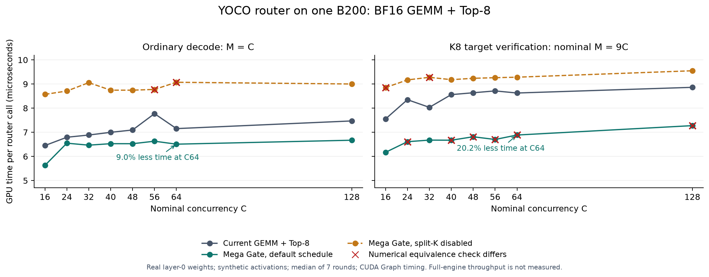

# B200 Mega Gate v1 finite-input microbenchmark (historical)

This report records the original v1 finite-input router measurements, when the candidate was off by default. v1 is now rejected because it can trap on nonfinite CUDA Graph padding. See [v2 whole-model results](FULLMODEL_RESULTS.md) for the padding fix, current Fast default and end-to-end results. The JSON's `default_enabled=false` describes this historical experiment.

The default Mega Gate schedule reduces the measured K8/C64 router time by **20.2%**, but fails strict numerical equivalence on some real-weight cases. Disabling split-K removes the observed expert-ID sequence differences, leaves probability differences in a few cases, and loses the high-concurrency speed advantage.

## Scope

One allocated B200 (physical GPU 7, UUID `GPU-4549436e-8247-c0d0-26a8-3b48a91fe43e`) in `living-cobra-b200g4-dev-f5def941-master-0`, node `slc01-cl02-hgx-0347`, under Linux account `fhb`. PyTorch is `2.13.0+cu130`; the patched DeepGEMM extension and headers are installed in a task-only virtual environment.

The baseline includes the existing BF16 GEMM and fused Top-8 softmax. Each measurement captures 200 complete router calls inside a CUDA Graph; seven GPU-event rounds alternate A/B order, and the table reports medians. There is no profiler in the timing path. Weights are the actual BF16 router cache for `model.layers.0.mlp.gate.weight` from `balanced-b040-c035-d025-hf`; that checkpoint already has normalized router weights. Activations are seeded synthetic BF16 tensors, not captured model activations.

C is a nominal request concurrency used to derive M, the rows reaching one router call. This is a router microbenchmark; it does not run a P/D engine or measure tokens/s, K8 acceptance, MATH-500, shared experts, TP/EP communication or KV transfer. The microbenchmark directly invokes the fused kernel, including below the provisional 128-row engine threshold.

## K8 target verification

Nominal M=9C for fully populated K8 verification batches. Actual scheduled batches may contain fewer rows. Time is microseconds per complete router call. Latency reduction uses the default schedule relative to its paired baseline.

| C | M | Current | Mega Gate | Time reduction | Split-K disabled | Default numerical check |
| ---: | ---: | ---: | ---: | ---: | ---: | :--- |
| 16 | 144 | 7.552 | 6.170 | 18.3% | 8.852 | Pass |
| 24 | 216 | 8.351 | 6.610 | 20.8% | 9.170 | Differs; 0 ID-sequence rows |
| 32 | 288 | 8.033 | 6.676 | 16.9% | 9.277 | Pass |
| 40 | 360 | 8.561 | 6.671 | 22.1% | 9.180 | Differs; 0 ID-sequence rows |
| 48 | 432 | 8.637 | 6.815 | 21.1% | 9.236 | Differs; 0 ID-sequence rows |
| 56 | 504 | 8.714 | 6.702 | 23.1% | 9.262 | Differs; 1 ID-sequence rows |
| 64 | 576 | 8.627 | 6.886 | 20.2% | 9.283 | Differs; 0 ID-sequence rows |
| 128 | 1152 | 8.863 | 7.276 | 17.9% | 9.549 | Differs; 1 ID-sequence rows |

## Ordinary decode

Nominal M=C. These are direct kernel calls, not end-to-end request measurements.

| C / M | Current | Mega Gate | Time reduction | Split-K disabled | Default numerical check |
| ---: | ---: | ---: | ---: | ---: | :--- |
| 16 | 6.451 | 5.627 | 12.8% | 8.571 | Pass |
| 24 | 6.794 | 6.549 | 3.6% | 8.709 | Pass |
| 32 | 6.886 | 6.467 | 6.1% | 9.057 | Pass |
| 40 | 6.999 | 6.528 | 6.7% | 8.745 | Pass |
| 48 | 7.096 | 6.527 | 8.0% | 8.745 | Pass |
| 56 | 7.771 | 6.630 | 14.7% | 8.776 | Pass |
| 64 | 7.152 | 6.508 | 9.0% | 9.073 | Pass |
| 128 | 7.470 | 6.671 | 10.7% | 9.001 | Pass |

## Prefill-size router calls

These rows use the Prefill cases from the K8 matrix; they measure the router component only.

| M | Current | Mega Gate | Time reduction | Split-K disabled |
| ---: | ---: | ---: | ---: | ---: |
| 1024 | 8.842 | 7.153 | 19.1% | 9.518 |
| 2048 | 9.836 | 8.520 | 13.4% | 10.004 |
| 4096 | 11.873 | 10.281 | 13.4% | 11.709 |

## Correctness and interpretation

The native suite passes **14/14 tests**, including BF16 rounding before ranking, stable ties, large negative logits and graph replay with updated inputs/weights. The first test attempt failed in its reference expression because PyTorch 2.13 requires `argsort(dim=-1, stable=True)`; the corrected test suite passes. The original attempt is preserved in the evidence.

With the default Mega Gate schedule, 7 of 18416 tested rows have a different expert-ID sequence across the two matrices, including their separate Prefill cases. This metric includes ordering differences; it does not distinguish a reordered Top-8 from a changed expert set. Maximum absolute selected-probability error is 0.00390595. All eight ordinary-decode cases have matching IDs and probabilities within tolerance. Some larger cases have matching IDs but different probabilities.

Disabling split-K with `deep_gemm.use_deterministic_algorithms(True)` yields zero expert-ID sequence mismatch rows in these samples. It still fails the selected-probability check in 4 of 22 cases; the maximum absolute probability difference is 0.00107445. At K8/C64, router time becomes 9.283 microseconds versus the paired 8.627-microsecond baseline, a 7.6% regression.

Strict equivalence requires identical expert-ID sequences and selected probabilities within `rtol=2e-6, atol=1e-7`. Both matrices intentionally return a nonzero status when this check fails, while saving all timing data. The failures are numerical-check failures, not kernel crashes. The experiment shows split-K scheduling affects the numerical result and performance; remaining differences still require a direct GEMM-logit comparison. Preserving the BF16 rounding boundary alone does not guarantee equality to cuBLAS accumulation.

The result supports further work on the fast schedule. It does not establish full-model output equivalence or quality. Real activation replay and full-model acceptance/quality tests are needed before enabling it. No engine throughput improvement is claimed.

## Evidence and cleanup

- Machine-readable matrix: [b200-summary.json](b200-summary.json).
- Plot: [PNG](router-latency.png), [SVG](router-latency.svg).
- Local experiment directory: `/data/vllm_test/work/yoco-mega-gate-b200-20261025/`.
- Remote isolated directory: `/home/fhb/yoco-mega-gate-b200-20261025/`.
- Build, scripts, initial source archive/manifest, compatibility test fix, full logs, per-round timings and runtime hashes are retained there.
- The patched extension resolves under the task virtual environment. The shared installed DeepGEMM and existing services were not changed.
- Pod UID remains `9a026fd8-e732-4fcb-b855-85ea6a6358ed`; restart count remains 0. GPU 7 memory returned to 0 MiB after each completed experiment; the advisory lock was released.
