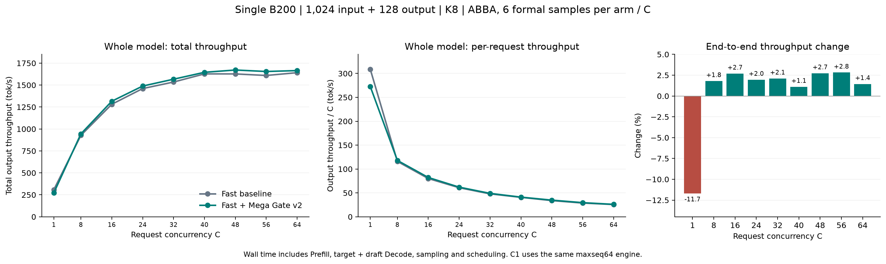

# Fast Mega Gate v2: whole-model B200 results

At C16–64, the padding-safe fused router improves whole-model throughput by
**1.1–2.8%** in this fixed workload. Pooling the C16–64 workloads by total output
tokens / total elapsed time gives **1576.29 → 1609.24 tok/s (+2.09%)**.
At C64, **1641.44 → 1665.20 tok/s (+1.45%)**.
The C1 control regresses **11.69%**; the Fast default is intended for compatible
high-capacity engines and is not a universal latency improvement.

## What changed

Fast defaults to `VLLM_YOCO_MEGA_GATE=1` only when its compatibility checks pass:
BF16 routing, SM100, H3072/E128/K8, single TP/PP/PCP/DCP/DP rank, EP/DBO off,
batch-invariant mode off, modular MoE, no route dump, and patched DeepGEMM API2.
Other cases keep their existing router. The gate threshold is 128 router rows.
Below it, BF16 GEMM + Triton Top-8 still executes.

The standalone engine falls back entirely when its configured maximum Decode rows
`max_num_seqs * (num_speculative_tokens + 1)` cannot reach the threshold.
For example, maxseq1/8 with K8 retain their previous Prefill and Decode router.
However, C1 inside this maxseq64 engine still uses the fused gate during
Prefill and can produce different continuation/acceptance. Set
`VLLM_YOCO_MEGA_GATE=0` before startup to restore the baseline.

The actual Top-k selection is DeepSeek DeepGEMM's unchanged `select_warp_topk`
and four-element sorting network. YOCO supplies BF16 logit rounding after the
complete accumulation, selected-eight FP32 softmax, INT32 expert IDs and padded
row handling. This is not the original DeepSeek scoring function: YOCO needs
softmax rather than sqrtsoftplus. DeepGEMM base:
`1fc9c66975ee322d628b3288534ca0e9ce12a64d`.
vLLM base: `7c3f32c985b5b98f83ee45ce9311d291a90b0348`, plus the local patch.

## Measurement

One allocated B200 GPU7 in the development Pod, no other work on that GPU.
Target `balanced-b040-c035-d025-hf`, FP8 block weights/activations, BF16 router
and KV; BF16 `draft-parent-30000`, DSpark K8 with probabilistic draft and
standard rejection. V2 runner, TP1, Fast Prefill, maxseq64, max batched tokens
2048, KV8GiB, maxlen139264, prefix caching off, asynchronous scheduling off,
in-process engine. Both arms use the same MegaMoE hybrid dispatch.

The order is baseline-a / fused-a / fused-b / baseline-b. Each process runs
C1/8/16/24/32/40/48/56/64, with two warmup batches and three formal seeds at
each C: **six formal samples per arm and C**. Every request has exactly 1024
input and 128 output tokens; temperature1, ignore EOS. Prompt token IDs and
model configuration are asserted identical across all four processes.
The prompt pool contains up to 64 instruction prompts derived from eight
topics, padded to 1K. The C1 control uses just its first math prompt.

Throughput is sum(output tokens) / sum(end-to-end elapsed time), including
Prefill, target verification, draft generation, sampling, scheduling and GPU
drain. Loading, compilation, warmup and profiling are excluded. No JIT warning
appeared in a formal trial; the logged initial JIT warnings precede trial0
warmup. These are offline whole-model batches, not a P/D service or a pure
Decode measurement. No statistical-significance or production-traffic claim is
made from these four processes.

| C | Baseline tok/s | Fused tok/s | Change | Baseline acceptance length | Fused acceptance length |
| ---: | ---: | ---: | ---: | ---: | ---: |
| 1 | 308.47 | 272.42 | -11.69% | 4.1579 | 3.4196 |
| 8 | 927.29 | 943.97 | +1.80% | 3.5823 | 3.5394 |
| 16 | 1281.36 | 1315.92 | +2.70% | 3.6453 | 3.5360 |
| 24 | 1460.33 | 1488.86 | +1.95% | 3.5873 | 3.5905 |
| 32 | 1534.73 | 1567.01 | +2.10% | 3.6627 | 3.5740 |
| 40 | 1627.55 | 1645.59 | +1.11% | 3.6660 | 3.5639 |
| 48 | 1627.13 | 1671.65 | +2.74% | 3.6329 | 3.5789 |
| 56 | 1609.50 | 1654.84 | +2.82% | 3.6231 | 3.5752 |
| 64 | 1641.44 | 1665.20 | +1.45% | 3.6445 | 3.5947 |

Acceptance length uses `1 + accepted_tokens / num_drafts` from trial-local
counter deltas. Within each arm, both repeated processes reproduce all
**27/27 output batches and 867/867 request token sequences** for matched C/seed.
This repeatability does not imply equality between baseline and fused outputs.

## Numerical limits and the padding fix

Mega Gate changes the GEMM/split-K accumulation order relative to the original
router. BF16 rounding and selection tie rules alone do not make it equivalent.
The historical [v1 finite-input microbenchmark](B200_RESULTS.md) documents
occasional expert-ID sequence and probability differences.

The four-prompt teacher-forced probe uses 32 fixed continuation tokens per
prompt, 128 tokens total: mean NLL **1.725466 → 1.764871**, exactly reproducible
within each arm. This is a small diagnostic, not a task-accuracy evaluation.
**MATH-500 has not been run for this fused candidate.** No unchanged-accuracy
claim is supported. The C1 acceptance change (4.1579 → 3.4196) accompanies its
throughput regression; its exact causal breakdown has not been isolated.

The initial v1 kernel passed finite-input microbenchmarks but trapped during
full-model shrinking-batch CUDA Graph replay: C16 shrank to 14 live requests,
126 active rows in a padded graph. A standalone reproduction confirmed that
NaN padding could trigger the scratch-wide validity trap.

v2 validates complete rows, masks nonfinite rows with IDs -1 and weights0,
and keeps finite-row Top-k math unchanged, without an extra kernel launch.
It requires extension marker2 and the new
`sm100_bf16_yoco_mega_gate_v2` JIT namespace. vLLM rejects v1. Full-model pilot
and all four ABBA arms finish with status0 after this fix.

## Validation and artifacts

- Native B200 suite: **18 passed**, including shrinking graph replay with
  NaN/Inf padding; local regression suite: **120 passed / 12 SM100 skips**.
- Offline SM100 compilation succeeds for single CTA, split-K and the original
  scoring function; dependency patch applies to the pinned DeepGEMM base.
- Every ABBA arm verifies its 20 router states and the API2 marker. Separate
  Prefill profiling confirms the actual native GPU kernel for the fused arm
  and BF16 router GEMM for baseline. Profiling is outside formal timing.
- A final run with the latest source and the gate environment variable unset
  verifies all20 default-on routers, native GPU execution and all20 resolved
  `deep_gemm_yoco_softmax_v2` compilation-cache tags. The final safeguards only
  change initialization/cache metadata in this measured maxseq64/BI0 setup;
  they do not change its forward math. This sanity run is not pooled into ABBA.
  Its C16/C64 formal output IDs match the corresponding fused-a seed exactly.
- Final hashes match all seven key local source files to the verified remote
  source; the private extension reports API2. GPU7 returns to 0 MiB, its lock
  is released, and the Pod keeps UID
  `9a026fd8-e732-4fcb-b855-85ea6a6358ed` with restart count0.
- The per-module backend enters the compilation hash, preventing stale AOT
  cache reuse when the available DeepGEMM implementation changes.
- Results: [JSON](fullmodel-summary.json), [PNG](fullmodel-throughput.png),
  [SVG](fullmodel-throughput.svg). Exact launch scripts, raw trials, profiler
  outputs and build/test logs are retained under the local task directory
  `/data/vllm_test/work/yoco-mega-gate-b200-20261025/` and remote isolated task
  `/home/fhb/yoco-mega-gate-b200-20261025/`.

The patched dependency is installed only in the task's private environment.
Shared Python packages, existing services and the original DeepInfer checkout
were not changed. Enabling this source elsewhere requires building the
[included dependency patch](../../../../tools/yoco_alignment/deep_gemm_yoco_softmax.patch);
without API2 it automatically falls back. No remote branch was pushed.
